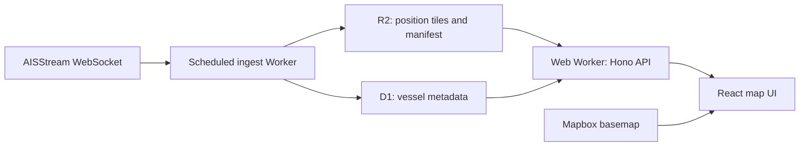

# Mariner

Mariner is an open-source vessel tracking application built on Cloudflare Workers, R2, and D1. It collects [AISStream](https://aisstream.io) data during scheduled listening windows and displays hourly vessel snapshots on an interactive Mapbox map.

## Features

- Interactive map with vessel markers colored by ship type and oriented by heading or course.
- Search by exact nine-digit MMSI or call sign.
- Vessel identity, voyage, dimensions, speed, course, and heading details when available.
- Light and dark themes, map navigation, and browser geolocation.
- Snapshot freshness indicators and automatic refresh when new data is available.

### Data freshness and scope

By default, ingestion starts at the top of each hour (UTC), listens for 600 seconds, then publishes a snapshot. The browser checks for new snapshots every minute. This is periodic tracking rather than a continuous live feed.

Positions carry forward between runs and expire after 24 hours during a successful ingest run. D1 metadata is pruned after 30 days without sightings. The snapshot update time indicates when publication finished; each vessel has its own position timestamp. D1's last-seen timestamp can lag because unchanged records are refreshed at most about every six hours.

Coverage and available fields depend on messages received from AISStream during the listening windows. Name search and historical tracks are not implemented. Markers are thinned at low zoom levels to keep the map responsive; zoom in to see more vessels.

## Prerequisites

- **Node.js 24** and **pnpm**. See the [pnpm installation instructions](https://pnpm.io/installation).
- An [AISStream account and API key](https://aisstream.io) for ingestion.
- A [Mapbox account and public access token](https://console.mapbox.com/) for the map.
- For deployment: a Cloudflare account with R2 enabled and the **Workers Paid** plan. Local D1 and R2 storage is emulated; production resources are not required for local development.

## Local development

After cloning the repository, run these commands from its root:

```sh
pnpm install
cp apps/ingest/.dev.vars.example apps/ingest/.dev.vars
cp apps/web/.env.example apps/web/.env
```

Set `AISSTREAM_API_KEY` in `apps/ingest/.dev.vars` and `VITE_MAPBOX_TOKEN` in `apps/web/.env`. Leave `VITE_POSTHOG_KEY` empty unless you want analytics. Initialize local D1 and start both services:

```sh
pnpm --filter ingest run migrate:local
pnpm dev
```

Open the URL printed by Vite (normally `http://localhost:5173`). Wrangler normally serves ingest on port `8787`; use its printed port if it differs. Local cron triggers do not run automatically. In another terminal, populate the local snapshot:

```sh
curl "http://localhost:8787/cdn-cgi/local/scheduled"
```

This request takes the listening window (10 minutes by default), plus storage work. The map stays empty until publication finishes. For a shorter development cycle, set `LISTEN_SECONDS=60` in `apps/ingest/.dev.vars` and restart ingest; shorter windows may collect fewer vessels. Avoid overlapping runs.

The web Worker shares local D1 and R2 state with ingest through the persistence path in [vite.config.ts](apps/web/vite.config.ts): `apps/ingest/.wrangler/state`. Local data is separate from production. The checked-in zero database UUID works as a local placeholder; replace it in both Wrangler configs before deploying. Changing `database_id` selects different local D1 state, so rerun `migrate:local` afterward. Also rerun it after pulling new migrations.

## Configuration

Local environment files are ignored by Git. Keep credentials in these files or Cloudflare secrets; use the checked-in example files as templates.

### Ingest (`apps/ingest`)

| Environment variable | Required | Default | Local configuration     | Production configuration                | Purpose                                                                                                                           |
| -------------------- | -------- | ------- | ----------------------- | --------------------------------------- | --------------------------------------------------------------------------------------------------------------------------------- |
| `AISSTREAM_API_KEY`  | Yes      | None    | `apps/ingest/.dev.vars` | Worker secret via `wrangler secret put` | Authenticates the AISStream subscription. Keep secret.                                                                            |
| `LISTEN_SECONDS`     | No       | `600`   | `apps/ingest/.dev.vars` | `vars` in `apps/ingest/wrangler.jsonc`  | Listening window in seconds. Use a positive value that leaves time for storage work before the cron execution limit and next run. |

The schedule is configured separately under `triggers.crons` in [apps/ingest/wrangler.jsonc](apps/ingest/wrangler.jsonc). The default is `0 * * * *` (hourly, UTC).

### Web (`apps/web`)

| Environment variable | Required                | Default                    | Local configuration | Production configuration   | Purpose                                                                        |
| -------------------- | ----------------------- | -------------------------- | ------------------- | -------------------------- | ------------------------------------------------------------------------------ |
| `VITE_MAPBOX_TOKEN`  | Yes, to display the map | None                       | `apps/web/.env`     | `apps/web/.env.production` | Mapbox public token (`pk...`). Restrict it to the appropriate domains.         |
| `VITE_POSTHOG_KEY`   | No                      | Unset; analytics disabled  | `apps/web/.env`     | `apps/web/.env.production` | Enables PostHog analytics and unhandled error/rejection capture when nonempty. |
| `VITE_POSTHOG_HOST`  | No                      | `https://us.i.posthog.com` | `apps/web/.env`     | `apps/web/.env.production` | PostHog ingestion host; use the host for your project if analytics is enabled. |

Vite embeds `VITE_*` values in the browser bundle at **build time**. These values are public: never put the AISStream key or private credentials in a `VITE_*` variable. Changing them requires rebuilding and redeploying the web app; deployed Worker runtime variables do not update the frontend. Vite also loads `.env` during production builds, so explicitly leave `VITE_POSTHOG_KEY` empty in `.env.production` to disable production analytics.

### Shared package (`packages/ais`)

`packages/ais` has no environment variables or runtime bindings. It provides shared schemas, types, and utilities.

### Cloudflare runtime bindings

Bindings are configured in the Wrangler files rather than environment files.

| Binding          | Projects       | Configuration                          | Purpose                                                                       |
| ---------------- | -------------- | -------------------------------------- | ----------------------------------------------------------------------------- |
| `VESSELS`        | Ingest and web | `r2_buckets`, bucket `mariner-vessels` | Position tiles and snapshot manifest.                                         |
| `DB`             | Ingest and web | `d1_databases`, database `mariner`     | Vessel identity and voyage metadata. Both apps must use the same database ID. |
| `SEARCH_LIMITER` | Web            | `ratelimits`, namespace `1001`         | Limits search to 30 requests per 60 seconds per client IP.                    |

## Architecture



| Directory      | Responsibility                                                                                                            |
| -------------- | ------------------------------------------------------------------------------------------------------------------------- |
| `apps/web`     | Vite/React UI, Mapbox, TanStack Query, and Hono Worker API. The same Worker serves frontend assets and `/api/*`.          |
| `apps/ingest`  | Cron Worker that listens to AISStream, publishes R2 tiles, and syncs metadata to D1 with Drizzle ORM. Owns D1 migrations. |
| `packages/ais` | Shared vessel schemas, database schema, types, ship classifications, and tile utilities.                                  |

R2 holds the current map snapshot in zoom-3 geographic tiles; D1 holds slow-changing vessel metadata. There is no position-history store. A run that receives no accepted AIS messages fails without replacing the previous snapshot. D1 sync failures are logged separately and do not prevent R2 publication.

### API

| Endpoint                                            | Behavior                                                                                                                                                   |
| --------------------------------------------------- | ---------------------------------------------------------------------------------------------------------------------------------------------------------- |
| `GET /api/status`                                   | Returns `{ updatedAt }`, or a null timestamp before the first publication. Use this for freshness checks.                                                  |
| `GET /api/vessels?bbox=minLng,minLat,maxLng,maxLat` | Returns `{ updatedAt, vessels }` for the bounding box. Coordinates are longitude/latitude in degrees; minima must not exceed maxima.                       |
| `GET /api/vessels/:mmsi`                            | Returns D1 vessel metadata, or `404` if unavailable.                                                                                                       |
| `GET /api/search?q=211518370`                       | Looks up an exact MMSI or call sign and returns `{ vessel, position }`. Either field can be null; no match returns `404`, and rate limiting returns `429`. |

Call signs are normalized to uppercase for lookup. Positions use compact tuple records; see [vessel.ts](packages/ais/src/vessel.ts) for field order and response types, and [schema.ts](packages/ais/src/schema.ts) for metadata fields. Successful vessel responses are cached for five minutes. The frontend polls `/api/status` and adds a `v` query parameter to position requests to bypass the previous snapshot's cache after publication.

## Deploying to Cloudflare from scratch

These steps provision one R2 bucket, one D1 database, and two Workers. Run commands from the repository root. The frontend is deployed as Worker assets; a separate Cloudflare Pages project is not needed.

Use the **Workers Paid** plan for the ingestion workload. The default 10-minute listening window must fit within the scheduled invocation limit with room for storage work. Review [Workers limits](https://developers.cloudflare.com/workers/platform/limits/) and pricing for [Workers](https://developers.cloudflare.com/workers/platform/pricing/), [R2](https://developers.cloudflare.com/r2/pricing/), and [D1](https://developers.cloudflare.com/d1/platform/pricing/) for your expected traffic and data volume.

### 1. Install dependencies and authenticate

Install the prerequisites above, enable Workers Paid and R2 in your Cloudflare account, then authenticate Wrangler:

```sh
pnpm install --frozen-lockfile
pnpm --filter ingest exec wrangler login
pnpm --filter ingest exec wrangler whoami
```

If you have multiple Cloudflare accounts, set `account_id` in both Wrangler configs to the chosen account. Complete your account's `workers.dev` subdomain setup in the dashboard if prompted.

### 2. Create the R2 bucket and D1 database

```sh
pnpm --filter ingest exec wrangler r2 bucket create mariner-vessels
pnpm --filter ingest exec wrangler d1 create mariner
```

Copy the `database_id` returned by the D1 command into **both** [apps/ingest/wrangler.jsonc](apps/ingest/wrangler.jsonc) and [apps/web/wrangler.jsonc](apps/web/wrangler.jsonc).

Keep the binding names `VESSELS` and `DB`; the code uses them. Both configs must point to the same bucket and database. R2 is accessed through Worker bindings and does not need public bucket access.

The default resource names are `mariner-vessels` and `mariner`; the Worker names are `mariner-ingest` and `mariner-web`. If you customize resource names, update both configs and the database name in the migration scripts in [apps/ingest/package.json](apps/ingest/package.json). Another deployment in the same account also needs distinct Worker names and a distinct search rate-limit namespace ID.

Earlier configs used `marginer-ingest` and `marginer-web`; preserve those names when updating an existing deployment if you want to keep its Workers, secrets, and URLs. Changing names creates new Workers and does not remove the old ones or their cron triggers.

### 3. Apply production database migrations

```sh
pnpm --filter ingest run migrate
```

This applies `apps/ingest/migrations/` to remote D1. Deploying code does **not** apply migrations. Repeat this step before deploying whenever new migrations are added. The local equivalent, `migrate:local`, does not modify production.

### 4. Configure the ingest secret and listening window

```sh
pnpm --filter ingest exec wrangler secret put AISSTREAM_API_KEY
```

Paste your AISStream key at the prompt. If the Worker does not exist yet, accept Wrangler's offer to create it, then deploy its code in step 6. The command uses the Worker name in the ingest config. Keep `LISTEN_SECONDS` at `600` in that config's `vars` unless you want a different listening window. Local `.dev.vars` values are not uploaded automatically. See [Cloudflare's secrets guide](https://developers.cloudflare.com/workers/configuration/secrets/) for secret management.

### 5. Configure the production frontend

Create `apps/web/.env.production` with:

```dotenv
VITE_MAPBOX_TOKEN=pk.your_production_public_token
VITE_POSTHOG_KEY=
VITE_POSTHOG_HOST=https://us.i.posthog.com
```

Replace the Mapbox token with your own. In Mapbox, restrict its allowed URLs to your deployment's `workers.dev` domain or custom domain. The default web URL is `https://mariner-web.<your-subdomain>.workers.dev`. Use a separate token that allows localhost for development. To enable production analytics, set your PostHog public project key and host before building.

### 6. Deploy both Workers

```sh
pnpm --filter ingest run deploy
pnpm --filter web run deploy
```

The ingest deployment installs its cron trigger. The web deployment builds the frontend and deploys its assets and API together. Wrangler prints the deployed URLs. Open the web URL and confirm the basemap loads with your production token.

For later releases, apply any new migrations first, then deploy both apps with:

```sh
pnpm run deploy
```

Use `run`: plain `pnpm deploy` is a built-in pnpm command, not this repository's deployment script.

### 7. Wait for the first snapshot and verify

Cron changes can take up to 15 minutes to propagate. Once active, the default schedule starts ingestion at the top of the hour, and the snapshot appears after the 10-minute listening window and storage work. The map stays empty until then. Local test URLs do not invoke a deployed Worker's scheduled handler. See [Cloudflare's Cron Trigger documentation](https://developers.cloudflare.com/workers/configuration/cron-triggers/).

To collect the first snapshot sooner, temporarily change the ingest config's `triggers.crons` to `["*/15 * * * *"]` and `vars.LISTEN_SECONDS` to `"60"`, then redeploy ingest. After the first successful run, restore `["0 * * * *"]` and `"600"` and redeploy again. Leave room between runs for storage work; avoid a 10-minute schedule with a 10-minute listening window.

Watch ingest logs during a scheduled run:

```sh
pnpm --filter ingest exec wrangler tail
```

Look for `ingest complete` and check separately for `d1 sync failed`. In another terminal, replace the example subdomain and check freshness and positions:

```sh
curl "https://mariner-web.<your-subdomain>.workers.dev/api/status"
curl "https://mariner-web.<your-subdomain>.workers.dev/api/vessels?bbox=-10,45,10,60"
```

After a successful run, `/api/status` returns a non-null timestamp that advances after subsequent successful runs. Select a vessel in the UI or search a known MMSI/call sign to verify metadata and search. A bounding box may legitimately contain no vessels.

## Troubleshooting

| Symptom                                               | What to check                                                                                                                                                                                 |
| ----------------------------------------------------- | --------------------------------------------------------------------------------------------------------------------------------------------------------------------------------------------- |
| Map unavailable or basemap fails to load              | Set `VITE_MAPBOX_TOKEN`, check Mapbox URL restrictions, and restart Vite or rebuild/redeploy production. Runtime variables cannot change the built frontend.                                  |
| Map loads but there are no vessels                    | Check `/api/status`. A null timestamp means no snapshot exists. Trigger local ingestion, or wait for the deployed cron and listening window to finish. Check ingest logs for upstream errors. |
| Ingestion reports no AIS messages                     | Check the AISStream key and upstream connectivity. The previous snapshot is preserved; its timestamp does not advance.                                                                        |
| Search or details fail while positions work           | Apply D1 migrations and check for `d1 sync failed` in ingest logs. R2 publication can succeed even when D1 sync fails.                                                                        |
| Local ingest finishes but the UI has no data          | Check both apps' bucket names and database IDs, and the Vite persistence path pointing at ingest's local state.                                                                               |
| Local D1 tables disappear after configuration changes | Local state is keyed by database ID. Rerun `pnpm --filter ingest run migrate:local` and ingest again.                                                                                         |
| Search returns no match                               | Use an exact MMSI or call sign. The vessel must have been received during a listening window; call sign lookup also requires D1 metadata. Name search is not supported.                       |
| Search returns `429`                                  | Wait before retrying; searches are limited to 30 per minute per client IP.                                                                                                                    |

## Contributing

Issues and pull requests are welcome. Include reproduction steps for bugs, and open an issue to discuss substantial changes before implementation. Follow [AGENTS.md](AGENTS.md), use pnpm, and keep shared types and schemas in `packages/ais`.

| Command             | Purpose                                                     |
| ------------------- | ----------------------------------------------------------- |
| `pnpm dev`          | Start both development services.                            |
| `pnpm build`        | Build the web app and run its build-time TypeScript checks. |
| `pnpm typecheck`    | Check TypeScript across all workspace packages.             |
| `pnpm lint`         | Run Oxlint.                                                 |
| `pnpm format`       | Format the repository with Prettier.                        |
| `pnpm format:check` | Check formatting without changing files.                    |

Before submitting a change, run:

```sh
pnpm typecheck
pnpm lint
pnpm format:check
```

[CI](.github/workflows/ci.yml) runs these checks on pushes and pull requests. There is currently no automated test suite; describe relevant manual verification in your pull request. For UI changes, check map and vessel interactions. For ingestion or schema changes, apply local migrations and complete a local ingest run.

## License and external services

Mariner's source code is available under the [MIT License](LICENSE).

AISStream supplies vessel data, Mapbox supplies the basemap, and PostHog is optional for analytics. Their services, data, and usage terms are separate from the source-code license. Use your own credentials and review each provider's terms for your deployment.
